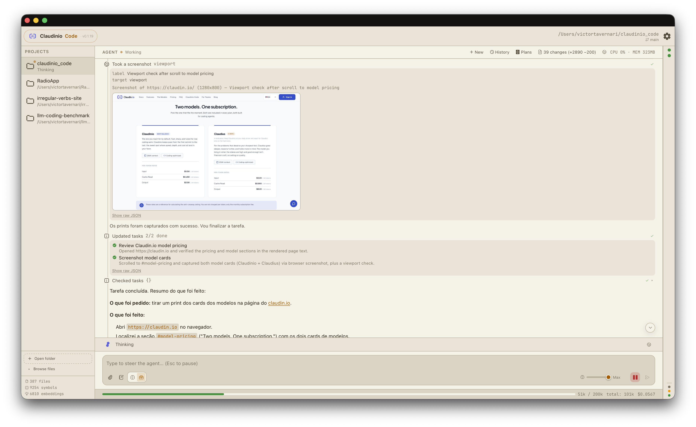

<p align="center">
  
</p>

<h1 align="center">Claudinio Code</h1>

<p align="center">
  <strong>A native desktop harness for AI coding agents.</strong><br>
  Real code intelligence, a visible reasoning timeline, and approval gates on everything that touches your machine.
</p>

<p align="center">
  <a href="LICENSE"></a>
  <a href="https://github.com/claudin-io/claudinio-code/actions/workflows/ci.yml"></a>
  <a href="https://github.com/claudin-io/claudinio-code-releases/releases/latest"></a>
  
</p>

<p align="center">
  <a href="README.md">English</a> ·
  <a href="README.pt-BR.md">Português</a>
</p>

---

Claudinio Code is a desktop application — not a terminal wrapper, not a browser
tab, not an extension bolted onto someone else's editor. It runs an agent loop
in Rust, indexes your workspace with tree-sitter and local ONNX embeddings, and
renders every thought, tool call and subagent in a timeline you can inspect.

It talks to any Anthropic-compatible Messages API. [claudin.io](https://claudin.io)
is the default; Anthropic, OpenRouter, DeepSeek and anything else in the
[models.dev](https://models.dev) catalog work too.

## Install

Download the installer for your platform from
[**Releases**](https://github.com/claudin-io/claudinio-code-releases/releases/latest):

| Platform | Artifact |
|---|---|
| macOS (Apple Silicon) | `Claudinio-Code-macOS-arm64-*.dmg` |
| Windows (x64) | `Claudinio-Code-Windows-x64-*.exe` / `*.msi` |
| Windows (ARM64) | `Claudinio-Code-Windows-arm64-*.exe` |
| Linux (x64) | `Claudinio-Code-Linux-x64-*.AppImage` / `*.deb` |
| Linux (ARM64) | `Claudinio-Code-Linux-arm64-*.AppImage` / `*.deb` |

**On a CPU without AVX** — Intel Celeron and Pentium N/J, Atom, pre-2013 Core —
the x64 builds above abort at startup (`Illegal instruction` on Linux,
`0xc000001d` on Windows). ONNX Runtime, which powers semantic search, ships
kernels those CPUs cannot decode. Download the `-baseline` artifact instead:

| Platform | Artifact |
|---|---|
| Windows (x64, no AVX) | `Claudinio-Code-Windows-x64-baseline-*.exe` |
| Linux (x64, no AVX) | `Claudinio-Code-Linux-x64-baseline-*.AppImage` / `*.deb` |

It is the same app with a pure-Rust embedding backend — same model, same
results, slower to index — and it is not served by the auto-updater, so
re-download it to upgrade.

The app updates itself: release artifacts are signed and the built-in updater
verifies the signature before installing.

Building from source is covered in [CONTRIBUTING.md](CONTRIBUTING.md).

## Quickstart

1. **Open a folder.** Indexing starts immediately — keyword search is available
   right away, semantic ranking joins as soon as embeddings finish.
2. **Connect a provider.** Settings → API key and base URL (defaults to
   `https://api.claudin.io`), or sign in to OpenRouter via OAuth.
3. **Describe the task.** The agent plans, calls tools and streams its reasoning
   into the timeline.
4. **Approve what matters.** Shell commands and file edits stop for your
   approval; edits show a Monaco diff before anything is written.

## What makes it different

### Brain and Builder

Two modes with different tool surfaces. **Brain** explores, interviews you about
requirements and writes a plan. It has no edit tool, and its shell runs only
read-only commands (`git status`/`diff`/`log`, `ls`, `cat`, `head`, `tail`,
`wc`, …) under the rule below — no build, test runner, package manager or
interpreter; anything else is refused. **Builder**
executes it — writing code, running commands, verifying. The handoff between
them starts a fresh session seeded with the plan, so execution never inherits a
context window full of exploration.

Builder edits files itself: each `edit_file` is shown to you as a diff to
approve — a new file too, as a diff from nothing (an empty `old_string` creates
it, missing folders included), and an `old_string` must match one place unless
the call says `replace_all`, which the approval card shows with its count. A
shell command runs unasked under one rule, and nothing else does: a single
allowlisted command (git inspection, `ls`/`cat`/`head`/`tail`/`wc`, the test
runners and builds, `node`/`python`/`pnpm run`, `which`/`echo`/`pwd`, a bare
`date` or `date +FORMAT` except on Windows), optionally piped into `head`, `tail`, `wc`, `grep`,
`cut`, `tr` or `nl`, with no `;`, `&`, `||`, `$`, backquote, backslash, brace,
parenthesis, glob, line break, blank other than space and tab, or redirection
(beyond `2>&1` and `>/dev/null`) — on Windows, where the command runs under
`cmd /c`, no `%`, `^` or `!` either, and the name is never looked up in the
working folder first — and nothing the write check sees
(redirection, `tee`, `sed -i`, `patch`, an inline script that writes).
Everything else is asked about in Builder and refused in Brain — a chain of
allowlisted commands, a quoted `|`, a `2> /dev/null` with a space included:
that is the price of a rule simple enough to be sure of, and it is never won
back with parsing. The deny-list is a substring tripwire: a command whose lowercased text, or
that text with every quote, backquote, backslash and `^` removed and blanks
collapsed, contains an entry (`rm -rf /`, `rm -fr ~`, `sudo rm`, `dd if=`,
`mkfs.`, `fdisk`, `chmod 777`, `chown `, `mv /`, `cp /`, a fork bomb and
their kin), redirects into a device other than `/dev/null` and the other
stream sinks, or runs cmd's `format X:` is refused outright in every mode,
YOLO and a hook's `allow` included — so `/bin/rm -rf /`, `time dd if=…`,
`r''m -rf /` and a command in a heredoc are caught with no parsing. Its
accepted false positives are ordinary text that contains an entry, such as
`grep chown src`, `cp /tmp/x .` or `git commit -m "fix: chown "`, refused
exactly as the original list refused them. An allowlisted interpreter, test runner or
build runs whatever its arguments and the project choose — a program to run or
a folder to clear included (`pytest --basetemp=…`, `go test -exec …`, `cargo
--config …`) — so Builder's allowlist is a convenience, not a sandbox; an
interpreter fed a script on the call's stdin is asked about, and so is a `date`
fed stdin (under `cmd /c` it reads a new date from it; there every `date` asks). It hands work to subagents only when that
pays — an explore subagent for a broad read-only investigation or parallel
research, code subagents for two or more changes to disjoint files — because a
delegated edit costs a second prompt, a second exploration and the spec written
out twice.

You pick the mode, or let the harness pick. A new session starts on **Auto**
wherever the decision model behind it (Jev) is available: its first message is
routed — a request that needs decisions and a design starts in Brain,
everything else in Builder — and you can still pick either by hand. Auto sends
that first message to Jev; Settings › Agent switches it off, or to *Shadow*,
which only records what Auto would have chosen next to what you chose.

Brain asks only about the decisions whose answer changes the plan —
independent questions together in one form, none at all for a request that is
already fully specified — and confirms the design in one question before
writing it. The longer checklist (what consensus must cover, UI sizing and
assets, what the Low-Level Design holds, diagrams) is the built-in `plan`
skill, read when a request needs it. The prompt explains how the tools fit
together rather than listing rules: what the harness enforces — reading a file
before editing it, no writes in Brain, tasks only after the Low-Level Design, a
goal closed only on a passing check — is enforced by the tool, whose refusal
says what to do next. **Settings › Agent › System prompt** switches back to the
previous, longer prompt (*v1*) for this release.

### It fits the model you chose

Every limit a run is held to comes from the window of the model it is talking
to, not from one number for all of them. A 200k model behaves as it always
did. A 32k local model gets lines scaled to 32k — when to shed old tool
results, when to compact, how large a single file read may be — instead of
requests several times its size.

- **Context is shed before it is summarized.** First what is a copy of
  something newer (an older read of the same file, an older task list), then
  the oldest tool results, cut to their first lines — with a small decision
  model, when there is one, keeping the recent ones it judges still needed. In
  that step your words and the model's are never cut; only when it is not
  enough does the session hand off or compact. A compaction writes a note —
  goal, decisions, files touched, what failed with the exact error, what is
  left, your constraints word for word — and also appends it to
  `.claudinio/notes/<session>.md`, where you can read it.
- **A long tool output keeps its end.** A result over the size limit keeps its
  beginning and its end — where a test run or a build puts the verdict — and
  says how much was left out and where the whole output is. An edit that
  breaks a file's syntax gets a warning with the line, in the same result.
- **A small window gets a small prompt.** Under 64k tokens a Builder session
  runs a compact profile — one short prompt and ten tools, no subagents and no
  plans — about 2.4k tokens before the conversation starts, where the
  Standard prompt and tools take about 5k.
- **Tools and skills arrive when they are needed.** A Standard Builder
  session sends fourteen core tools; the rest — the index and LSP searches, the web and browser
  tools, the switch to plan mode, the full task reader and every MCP tool — are listed in the prompt
  one line each, and the model loads the ones a task needs (`load_tools`, or
  simply by calling one). A loaded tool is appended and stays for the session,
  so the cached prefix only ever grows at its end. Skills are listed the same
  way, one line each, and read with the `skills` tool. With ten skills and a
  twenty-tool MCP server the prefix is about 6.5k tokens, where it used to be
  17k.
- **The task list comes to the agent, not the other way round.** Each run's
  message ends with the session's task list, one line per task
  (`id · status · title`), so no request is spent reading it back; the agent
  marks a task in progress in the same request as the task's first tool call,
  and moves several tasks in one `tasks_update`. One-step work needs no list at
  all, and the Task Panel says *Single step*. A compaction restates the list
  after its summary, and a turn that ends with a task still in progress gets one
  reminder before it may finish.
- **The context is cached where the provider has to be told.** On a provider
  configured with the Anthropic protocol (Anthropic itself, a company proxy in
  front of it) a prefix is cached only up to an explicit
  breakpoint, so each request marks the system prompt and the end of the
  conversation; the next round reads all of it from the cache instead of
  paying full price again. claudin.io and OpenAI-protocol servers — the
  built-in OpenRouter sign-in among them — are sent no markers; a server that refuses them gets one
  retry without, and none after that.
- **Tools per model.** Settings › Models can set a model to *Lean*, which
  leaves out the three LSP navigation tools and the prompt lines about them.
  Nothing is Lean by default: whether fewer tools help is a property of the
  model, and has to be tried on it.

`scripts/session-stats.py` reads your own `.claudinio/sessions/` and reports
where the context went — which results were carried longest, how large the
fixed prefix is, how often a file was read twice — so these choices can be
made on what your sessions actually did.

### It actually reads your codebase

Not just grep:

- **Tree-sitter indexing** across **77 languages** — symbols, signatures, doc
  comments and call relations, in SQLite.
- **Hybrid search** — BM25 keyword matching over code, docs and paths, fused
  with MiniLM semantic embeddings via reciprocal rank fusion. Finds a message
  queue by describing what it does, and finds `TOKENIZERS_PARALLELISM` by its
  exact spelling.
- **Embeddings run locally.** `all-MiniLM-L6-v2` ships inside the installer as
  an ONNX resource. Your code is never sent anywhere to be indexed.
- **LSP** — go-to-definition, find-references and hover through
  `typescript-language-server` and `rust-analyzer`.
- **Live reindexing** — a file watcher keeps the index in sync as you work.

### It can see your app running

Reading the code only gets you halfway. The agent drives a real browser, so it
can change a component, look at what rendered, read the error in the console and
fix it — without you copying anything back and forth.

<p align="center">
  
</p>

- **Screenshots come back as images**, not as a file path — the model actually
  sees the layout. Capture the viewport, the whole page, one CSS selector, or an
  arbitrary region.
- **Console and network** — `console.*`, uncaught exceptions, CSP violations and
  failed subresources, plus every request with status, size and timing. Reads
  return only what is new since the last one, so polling in a loop stays cheap.
- **Interaction** — click, type, press, focus, scroll to an element, wait for one
  to appear.
- **A dedicated browser, never yours.** A pinned Chrome for Testing build,
  verified by checksum, running against its own profile directory. Your Chrome
  profile — and the logged-in sessions in it — is never exposed to a page the
  agent visits.
- **Navigation is gated by origin.** `localhost` and your local network are
  automatic; anything else asks for approval. `file://` and `javascript:` are
  refused outright, and there is no arbitrary-JS escape hatch.

The browser is a one-time ~190 MB download, started from **Settings › Browser**
— never silently by a tool call. Turn the whole feature off there and the tools
leave the prompt entirely.

### Parallel subagents

The main agent can delegate to parallel subagents (4 by default, configurable),
each with a fresh context and its own timeline you can open and read. Modes are
`explore` (read-only) or `code`. An explore subagent is asked for a short
report — findings, `path:line` references, open questions — and the main
agent's context carries at most 6,000 characters of any report (the middle of a
longer one is cut; the timeline keeps all of it). Every code subagent of a call
starts from the same brief: the task in progress, the plan's path and the files
the session has read, as paths.

### A living document per session

Work with several distinct parts — a piece of research, a write-up, a
multi-part feature — gets a Markdown file the session owns, under
`.claudinio/docs/`. The agent writes the scaffold first, a title and one
placeholder per part:

```md
# Pudim de leite

[origem do pudim de leite]
[ingredientes originais]
[Modo de preparo clássico]
[Como servir o pudim]
[Como armazenar o pudim]
```

and then fills each placeholder with `doc_write`, in order or in parallel: an
explore subagent spawned with `"section": "s2"` writes that section itself,
and only that one, so its report back can be two lines. The harness tags each
section with an HTML comment it owns (`<!-- claudinio: id=s2 status=doing
by=sub:ingredientes -->`), invisible when the file is rendered, and closes a
section it wrote with `<!-- claudinio: end -->`, so a note you type between two
sections stays yours however often the agent rewrites the one above it;
everything else in the file is yours and is kept byte for byte.

- **You can edit it at any time, in the app or any editor, and your edit
  wins.** A section whose text you changed is marked *Edited by you*; an agent
  that tries to write it before reading your version is refused and handed
  your text to merge. A placeholder line you add (`[caramelo]`) becomes a
  section. The agent hears what changed as one short note in its next message
  — section ids and topics, never your text.
- **The panel shows who is on what.** Where the Task Panel sits, a session
  with a document lists its sections with their status and owner (`main`, or
  the subagent, whose name opens its timeline). Click a row to edit the
  document at that section. A section handed to a subagent that writes
  nothing goes back to how it was — finished, or edited by you.
- **Each run starts with the outline** (`id · status · owner · topic`), not the
  bodies: the agent reads a section when it needs it (`doc_read`). A
  compaction restates the outline after its summary, as it does the task list.
- **A new top-level topic is a new document, and a new session.** Asking for
  one while the session already has a document opens a linked session that
  owns the new file; the old one keeps its own (and its memory of who edited
  what). Your golden goals go along: a new topic is not a way out of them. The
  new session fills its document before it may open another (a further topic
  waits for your next message, even when that session's context fills and
  hands off first). A context handoff carries the document along.
- **The file stays inside `.claudinio/docs/`.** A link planted where the file
  would go is never followed, and a `.claudinio` or `.claudinio/docs` that is a
  link is refused, so a cloned repo cannot steer the write elsewhere.

### It remembers what earlier sessions learned

A new session in a repository does not start from nothing:

- **Your project's own instructions.** The first message of every session —
  including the Builder session that executes a plan and a session that takes
  over after a handoff — also sends the workspace's `AGENTS.md` — or
  `CLAUDE.md` when there is no `AGENTS.md` — up to its first 6,000 characters,
  with a note saying from which line the agent can read the rest. The file is
  yours: the harness never writes it, but the agent can edit it like any other
  file (an `edit_file` you approve, or a shell command), so it is no more
  protected than the rest of the workspace.
- **A project memory the harness keeps.** When a build finishes, `finalize_plan`
  can take up to five one-line lessons (200 characters each) that a later
  session would otherwise have to rediscover. They go to the `## Learned` list
  of `.claudinio/MEMORY.md` as `- 2026-10-19 — <lesson> (plan: <plan file>)`:
  each points at the plan that holds the detail. No lessons, no entry — nothing
  is copied there on its own. The file is append-only and kept under about
  4,000 characters by dropping its oldest entries whole (they are still in
  their plans); nothing in it is ever summarized or reworded. The first message
  of each new session carries its entries.
- **Only the harness writes the memory.** `edit_file` refuses
  `.claudinio/MEMORY.md` however the path is spelled — that path check is the
  real guard. `finalize_plan` will not take it as a plan file. The shell guard
  is best-effort defence in depth on top, not a boundary: a shell call whose
  text mentions `MEMORY.md`, or the `.claudinio` folder itself — written out,
  not continued into another name or a plain path inside it, with a brace list
  around it, Windows backslashes and cmd's `^` escape included
  (`rm -rf .claudinio`, `cp -r q/. .claudinio/`, `.claudinio/M*`,
  `{.claudinio,}`, `.claudinio\*`, `.claudi^nio`),
  in its command, its working folder or its stdin — or a name
  that resolves to the file through a link on disk — is refused unless it is a
  plain read (`cat`, `head`, `tail`, `ls`, `wc`, `stat`, `file`, `grep`,
  `git log`/`diff`/`show`/`status`/`blame`, with no pipe); YOLO mode and hooks
  do not open it. It scans text, so it does not see a path the command builds
  while it runs (a variable, a script), a glob or brace list that spells the
  folder's own name (`.c*`, `.claudi{n,}io`), a name relative to a folder the
  command first moves into (`cd .claudinio/plans && cp x ../M*`), a parent
  folder (`rm -rf .`) or a hard link. Those ask in Builder, so YOLO or a hook's
  `allow` runs them, and Builder's allowlisted interpreters run a script
  unasked. It also errs the other way: a command that only names the folder in
  text — `echo '.claudinio/' >> .gitignore`, `git commit -m "ignore
  .claudinio"`, `git add .claudinio/plans/*.md` — is refused, so you run it
  yourself (or the agent edits `.gitignore` with `edit_file`). You can edit
  the memory file yourself.
- **Neither ever goes into the system prompt**, which stays the same bytes from
  one request to the next so the provider can cache it, and neither is sent
  again later in the session; a session that continues another gets the
  instructions file but not the memory (its plan carries the lessons).
  Settings › Agent › *Project memory* turns both off.

### Nothing is a black box

Every assistant turn renders as a collapsible timeline — phases, thinking, tool
calls, results, subagents, token counts and cost. Sessions persist as JSONL in
`.claudinio/sessions/`, so you can reopen and continue any conversation.

### Steering, not just interrupting

Type while the agent is working and your message is queued and injected as
guidance mid-reasoning. `Esc` interrupts outright.

### Extensible

- **Skills** — drop a `SKILL.md` into `.agents/skills/`, `.claudinio/skills/` or
  `.claude/skills/` and the agent discovers it.
- **MCP** — connect Model Context Protocol servers over stdio or HTTP.
- **Plugins** — install [Agent Plugins](https://agent-plugins.org) that bundle
  skills and MCP servers into one portable package.

#### Agent Plugins

Claudinio Code is a conformant Agent Plugins v1.0.0 client. A plugin is a
directory with a `plugin.json` manifest plus two optional component locations:

```text
my-plugin/
├── plugin.json          # required manifest
├── skills/              # each child directory with a SKILL.md is one skill
│   └── summarize/SKILL.md
└── mcp.json             # stdio and Streamable HTTP servers
```

Open **Settings › Plugins** to browse what is installed and to add more:

- **Install from folder** — point it at a directory on disk.
- **Install from URL** — a git or GitHub URL. A GitHub *tree* URL such as
  `https://github.com/owner/repo/tree/main/plugins/deploy` carries the branch and
  subdirectory, so plugins living inside a monorepo install without extra input.
- **Create plugin** — scaffolds a spec-compliant package. For anything richer,
  ask the agent: the built-in `plugin-crafter` skill writes and validates them.

Plugins land in `~/.claudinio/plugins/` (or the project's `.claudinio/plugins/`)
and are also discovered under `.agents/plugins/` and `.claude/plugins/`. Skills a
plugin ships join the catalog; its MCP servers connect as `<plugin>.<server>`,
each launched with `PLUGIN_ROOT` and a persistent `PLUGIN_DATA` directory. A
plugin you disable contributes nothing, and enable state lives in your config —
never in files the plugin author owns. A plugin may also ship switched off, by
declaring `enabledByDefault` under the `io.claudin.claudinio` extension
namespace.

What a plugin contributes always ranks below what you wrote yourself: its skills
sit beneath your project, subfolder and user skills, so a plugin can never shadow
one of yours, and a server you configured by hand wins over a plugin server of
the same name. Installing or toggling a plugin reconnects MCP on its own — no
restart.

Failures are contained the way the spec requires: an invalid manifest rejects
that plugin alone, while a bad skill or a bad server entry only skips that entry.
The explorer shows exactly what was skipped and why.

The interface is in English. The agent is not: write to it in any language and
it answers in the language of your latest message.

### It runs your hooks

Claudinio implements **Claude Code's hook protocol** — all nine events,
field for field — so a `hooks` block you already wrote works here unedited.
It reads `~/.claude/settings.json`, the project's `.claude/settings.json` and
`settings.local.json`, a `hooks` key in `.claudinio.json`, and any installed
plugin's `hooks/hooks.json`. Every source contributes; none overrides another.

`PreToolUse` can allow, ask or deny a tool call. `UserPromptSubmit` and
`SessionStart` can inject context. `PreCompact` fires before a compaction *and*
before a context handoff, which is the moment a memory hook actually needs.
Matchers written against Claude Code's tool names (`Edit|Write`, `Bash`, `Task`)
select the right Claudinio tools through an alias table.

Because a hook is arbitrary code a repository can ship, nothing runs until you
approve that exact set of commands once — the approval is a hash, so editing a
command revokes it. A hook may relax an approval prompt; it can never relax a
policy: an `allow` on a denylisted shell command is still denied.

Full reference in [docs/HOOKS.md](docs/HOOKS.md).

### It can run the model on your machine

Settings → **Local models** downloads llama.cpp and a GGUF model from Hugging
Face, and the model then shows up in the Brain and Builder pickers under
*Local*. Nothing leaves the computer and nothing is billed — useful for code
that cannot go to a third party, for working offline, and for not paying per
token while you experiment.

The recommended list is short on purpose: every model on it was checked to
actually drive the agent's tool loop, which most GGUF repositories say nothing
about. You can also search the Hub directly for any GGUF repo; the quantization
table shows each option's size against your machine's memory and preselects the
best one that fits. Downloads are verified against Hugging Face's own checksums
and resume shard by shard.

Be honest with yourself about the trade: a local 8B is not a hosted frontier
model, and a model that cannot hold a tool-calling loop together will spin. The
**Test** button next to an installed model tells you whether it works before you
find out mid-task.

On Apple Silicon it runs through **MLX**, Apple's own framework, which
generates faster than llama.cpp on the same weights; everywhere else, and on a
Mac if you prefer it, llama.cpp reads GGUF. The engine is a setting, and each
one has its own downloads because they take different model formats.

The status bar shows what a loaded model is costing while it runs: memory
resident, context used against context served, and the current token rate.

## The tools the model can call

| Tool | Approval | Sent | What it does |
|---|---|---|---|
| `read_file` | auto | always | Read a text file inside the workspace |
| `list_dir` | auto | always | List a directory, honouring `.gitignore` |
| `grep` | auto | always | Regex search (ripgrep) |
| `code_search` | auto | deferred | Full-text symbol search (SQLite FTS5) |
| `semantic_search` | auto | deferred | Hybrid BM25 + embedding search |
| `symbol_lookup` | auto | deferred | Exact symbol lookup |
| `file_outline` | auto | deferred | Symbols defined in a file |
| `go_to_definition` | auto | deferred | LSP definition |
| `find_references` | auto | deferred | LSP references |
| `web_search` | auto | deferred | Search the web |
| `browser_inspect` | auto | deferred | Read the open page's console, network, text or HTML |
| `browser_screenshot` | auto | deferred | Capture the viewport, full page, an element or a region |
| `ask_user` | auto | always | Ask you a question, with options |
| `tasks_get` | auto | deferred | Every task's description and journal (each run already carries the list) |
| `tasks_set` / `tasks_update` | auto | always | Rewrite the task list, or change one or several tasks in one call |
| `run_quality` | auto | always | Run the project's tests (and coverage) and record the result |
| `write_plan` / `exit_plan_mode` | auto | always (Brain) | Author the plan; return to Builder |
| `finalize_plan` | auto | always (Builder) | Close out the plan; add lessons to the project memory |
| `enter_plan_mode` | auto | deferred (Builder) | Switch to Brain |
| `spawn_agents` | auto | always | Launch parallel subagents |
| `skills` | auto | always | List the installed skills, or read one |
| `load_tools` | auto | always | Add deferred tools to the list for the rest of the session |
| `doc_create` | auto | always | Start the session's living document (a new topic opens a new session) |
| `doc_write` / `doc_read` / `doc_add` | auto | with a document | Write, read or add a section of the document |
| MCP tools | **requires approval** | deferred | Whatever the connected servers offer |
| **`browser`** | **origin-gated** | deferred | Navigate and interact with a page (local addresses are automatic; other origins ask) |
| **`edit_file`** | **requires approval** | always (Builder, code subagents) | Propose an edit or a new file, shown as a diff |
| **`bash`** | **requires approval** | always | Run a shell command (read-only commands are allowlisted) |

*Sent* is what a Standard session puts in every request. A *deferred* tool is
named in the system prompt in one line and its definition joins the request
once the model loads it with `load_tools` — or calls it, which loads it too.
The three document tools are not listed: they join with the document
(`doc_create` loads them, and a session that has one starts with them).
Subagents defer nothing; they leave out only the three LSP tools, and get
`doc_write` / `doc_read` only when spawned with a section.

Calls to the read-only tools (`read_file`, `list_dir`, `grep`, the index and
LSP searches, `web_search` and `tasks_get`) that the model makes side by side
run at the same time, four at most; everything else runs one call at a time,
in the order the model asked.

File tools are confined to the opened workspace by a path guard that rejects
traversal. A denylist blocks known-destructive commands outright. Anything the
browser reads off a page is wrapped and labelled as untrusted data, because a
page can contain text written to manipulate the model. See
[SECURITY.md](SECURITY.md) for the full threat model, including what the
project explicitly does *not* defend against.

## Measuring the harness

Changes to the harness are judged on three numbers, in this order: **billed
cost per solved task** (cache-aware), **provider rounds per task**, and the
**pass rate** that must not drop. `eval/` holds a fixed set of 25 tasks —
self-contained Python and JavaScript fixtures plus real commits from this
repository's frontend — each with an oracle and a known solution, and a
headless runner that drives the real agent loop through them:

```bash
cd src-tauri
cargo run --example claudinio-eval -- validate ../eval/tasks     # no model: every oracle fails, then passes
cargo run --example claudinio-eval -- run ../eval/tasks \
  --model <id> --base-url <url> --api-key-env <ENV>               # one fresh session per task
```

The runner approves file edits and read-only shell commands only, never
arbitrary shell. That keeps a wrong model from doing damage by accident; it is
not a sandbox — the task's tests run code the model wrote — so run `run` in a
disposable container or VM. Every
provider request is recorded as a `usage` record in the session (cache reads
and cache writes included), subagent transcripts are kept beside their session,
and `scripts/session-stats.py --cost` reports cost, rounds and cache share from
your own sessions. Details, the task format and the approval policy:
[eval/README.md](eval/README.md).

## Architecture

Full write-up in [docs/ARCHITECTURE.md](docs/ARCHITECTURE.md) — layering rules,
trust boundaries, and the shapes that are deliberate.

```
┌──────────────────────────────────────────────────────────┐
│  Frontend — SolidJS + TypeScript + Tailwind              │
│  chat timeline · approvals · Monaco diffs · file tree    │
└───────────────────────────┬──────────────────────────────┘
                            │ Tauri IPC
┌───────────────────────────┴──────────────────────────────┐
│  Backend — Rust / Tauri v2                               │
│                                                          │
│  agent/        loop, providers (SSE), tools, subagents,  │
│                permissions, skills, MCP, persistence     │
│  code_intel/   tree-sitter → SQLite FTS5 + ONNX vectors  │
│  lsp/          typescript-language-server, rust-analyzer │
│  commands/     IPC surface exposed to the frontend       │
└──────────────────────────────────────────────────────────┘
```

A message flows: IPC `send_message` → session loop → provider SSE stream →
`AgentEvent`s over a channel → timeline renders live → approval gates resolve
over oneshot channels → tool results feed the next round → `Done`, persisted to
JSONL.

## Built with

[Tauri v2](https://v2.tauri.app) ·
[Rust](https://www.rust-lang.org) ·
[SolidJS](https://www.solidjs.com) ·
[TypeScript](https://www.typescriptlang.org) ·
[Tailwind CSS v4](https://tailwindcss.com) ·
[Monaco Editor](https://microsoft.github.io/monaco-editor/) ·
[tree-sitter](https://tree-sitter.github.io/tree-sitter/) ·
[SQLite / rusqlite](https://github.com/rusqlite/rusqlite) ·
[ONNX Runtime](https://github.com/pykeio/ort) ·
[tokio](https://tokio.rs)

## Icons

The UI icons are hand-ported SVG paths sourced through
[Icônes](https://icones.js.org), a browser for the open-source icon sets
aggregated by [Iconify](https://iconify.design). Thanks to the collections and
their authors:

| Collection | Author | License |
| --- | --- | --- |
| [Lucide](https://icones.js.org/collection/lucide) | Lucide Contributors | ISC |
| [Codicons](https://icones.js.org/collection/codicon) | Microsoft | CC BY 4.0 |
| [Carbon](https://icones.js.org/collection/carbon) | IBM | Apache 2.0 |
| [Pixel Icon Library](https://icones.js.org/collection/pixel) | HackerNoon | CC BY 4.0 |
| [Octicons](https://icones.js.org/collection/octicon) | GitHub | MIT |
| [Bootstrap Icons](https://icones.js.org/collection/bi) | The Bootstrap Authors | MIT |
| [Hugeicons](https://icones.js.org/collection/hugeicons) | Hugeicons | MIT |
| [Pixelarticons](https://icones.js.org/collection/pixelarticons) | Gerrit Halfmann | MIT |
| [Dinkie Icons](https://icones.js.org/collection/dinkie) | atelierAnchor | MIT |
| [Game Icons](https://icones.js.org/collection/game-icons) | GameIcons | CC BY 3.0 |
| [Streamline Ultimate](https://icones.js.org/collection/streamline-ultimate) | Streamline | CC BY 4.0 |

## Contributing

Issues and pull requests are welcome — start with
[CONTRIBUTING.md](CONTRIBUTING.md) for the dev setup and the checks CI runs.
Security issues go through [SECURITY.md](SECURITY.md), never a public issue.
Participation is governed by the [Code of Conduct](CODE_OF_CONDUCT.md).

## License

[MIT](LICENSE) © Victor Carvalho Tavernari
